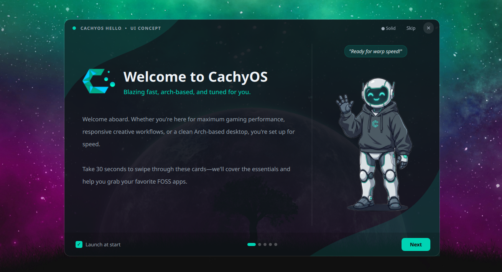
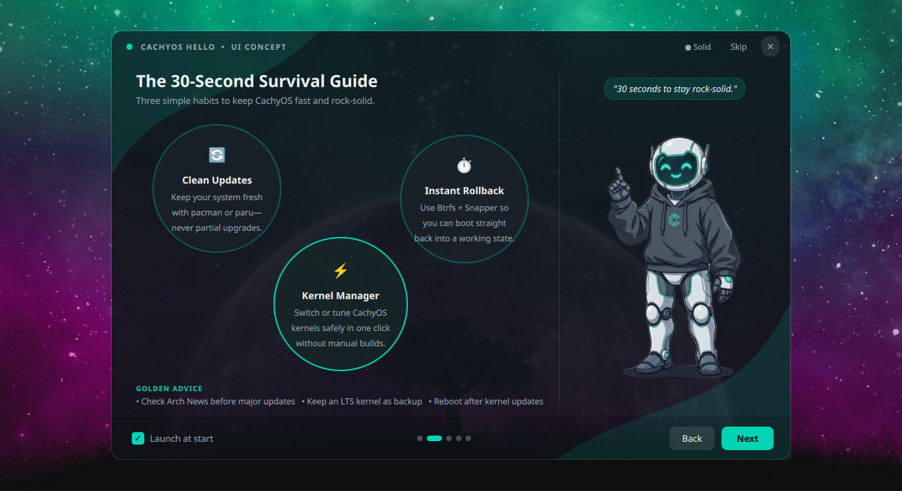
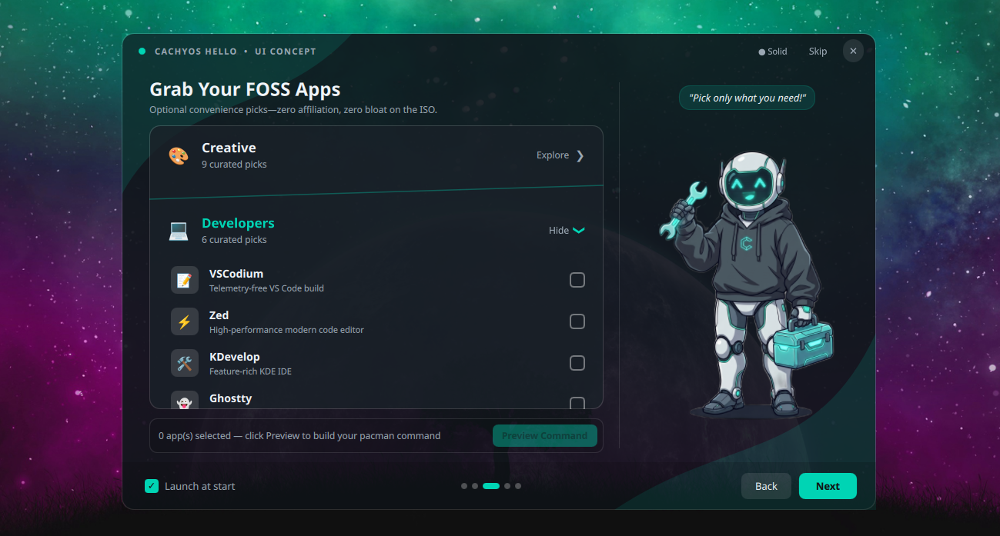
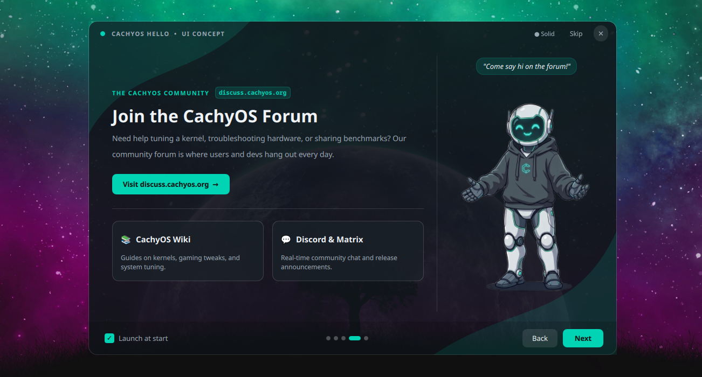
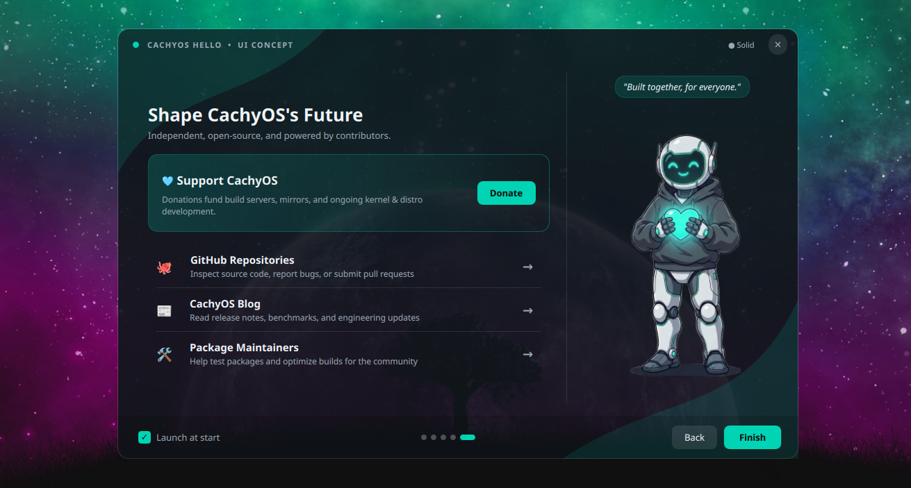

# CachyOS Hello — UI/UX Concept Mockup

A lightweight **Qt6 + QML** UI/UX concept mockup for a modernized `cachyos-hello`, designed to welcome newcomers without bloating the ISO.

*(Note: This is strictly a visual/UX layout concept to spark ideas. The right-hand character is a placeholder to demonstrate the 1/3rd visual stage.)*

## Preview



| 30-Second Survival Guide | Grab Your FOSS Apps |
| :---: | :---: |
|  |  |

| Community | Contribute & Support |
| :---: | :---: |
|  |  |

## Highlights
- **5-Card Horizontal Walkthrough:** Smooth swipe/arrow-key navigation with a frameless UI and a **Glass / Solid** accessibility toggle in the top bar.
- **30-Second Survival Guide:** Jargon-free onboarding covering clean `pacman`/`paru` updates, the CachyOS Kernel Manager, and Btrfs Snapper rollbacks.
- **JSON-Driven FOSS App Picker:** Non-hardcoded categories (`data/apps.json`) in a slanted accordion layout with clear *Proprietary* badges and a copyable `pacman` command preview.

## Quick Run
```bash
sudo pacman -S --needed pyside6 noto-fonts
git clone [https://github.com/AwwsmGaurav/cachyos-hello-concept.git](https://github.com/AwwsmGaurav/cachyos-hello-concept.git)
cd cachyos-hello-concept
python main.py
```
Or install locally via `makepkg -si` and run `cachyos-hello-concept`.